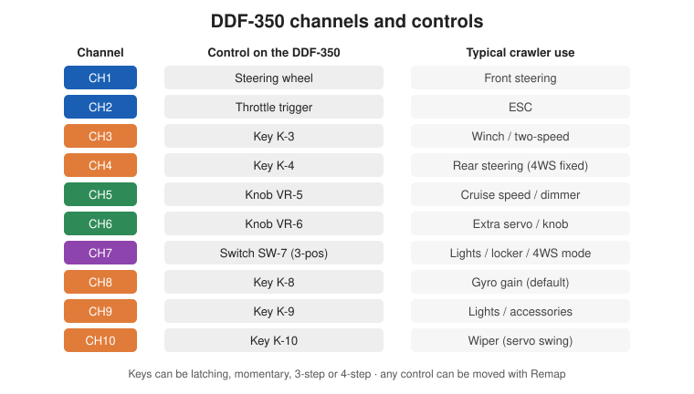
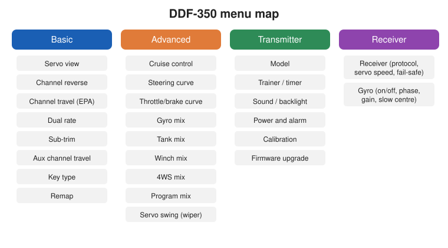

# DumboRC DDF-350 Transmitter

A 10-channel 2.4 GHz pistol-grip (wheel) radio for cars, crawlers, boats and tanks, with a colour
screen, receiver telemetry, gyro control from the transmitter, crawler mixes (4WS, winch, tank), cruise
control and USB firmware updates. Also sold in Europe as the **Amewi DDF-350** (art. 28380).

Related: [Receivers](receivers.md) · [Setup Guide](setup-guide.md) ·
[Firmware and Modifications](firmware-and-mods.md) · [Tips and Troubleshooting](tips.md)

## Specifications

From DumboRC's own manual unless noted.

| | |
|---|---|
| Channels | 10 (depends on receiver) |
| Frequency | 2400–2483.5 MHz, FHSS 67 channels, GFSK |
| RF power | < 20 dBm |
| Range | 350 m (reviewers report 350–500 m depending on surroundings) |
| Telemetry | Receiver battery voltage and signal strength (RSSI), about 40 m return range, on receivers that support it |
| Model memories | 10 |
| Screen | 2.4-inch colour, adjustable backlight |
| Power | 5–12 V DC: 4 × AA cells, or a 2S–3S Li-ion/LiPo pack via the JST plug in the battery bay. Reverse-polarity protected |
| Current | 88 mA ±10 mA at 8.4 V with the screen on |
| Size | 152 × 95 × 202 mm |
| Weight | 280 g (manual, without batteries); a review measured 778 g (likely as packed — check) |
| Ports | USB-C (firmware, data, temporary power — **not for charging**), PPM in/out (trainer, simulator, head tracking) |
| Languages | English (default), Chinese, German, French, Japanese |

## Controls and channels

| Channel | Control | Notes |
|---|---|---|
| CH1 | Steering wheel | Steering |
| CH2 | Throttle trigger | Throttle/brake |
| CH3, CH4 | Keys K-3, K-4 (above the screen) | Latching, momentary, 3- or 4-step |
| CH5, CH6 | Knobs VR-5, VR-6 | Travel adjustable; used for cruise speed, gyro gain, wiper speed |
| CH7 | 3-position switch SW-7 | |
| CH8–CH10 | Keys K-8, K-9, K-10 (on the grip) | Latching, momentary, 3- or 4-step; CH8 is the default gyro-gain control |
| — | Trims for steering and throttle | Trim offset up to 60 % (firmware 1.1.5+) |
| — | Dial (roller/push wheel) | Menu navigation |
| — | HOME/power key | Hold about 1.5 s to switch on; system menu |

Any control can be moved to another channel with **Remap**.

## Home screen

Model name · transmitter battery voltage · bars for all 10 channels · trims · mix and cruise icons ·
receiver voltage · signal strength (**NULL** = no link or not bound) · timer · settings lock.

## Menu reference

### Basic settings

| Function | What it does | Range / options |
|---|---|---|
| **Servo view** | Live bars for CH1–CH10 — check reverses, mixes and knobs | — |
| **Channel reverse** | Reverses a channel's direction | Per channel |
| **Channel travel (EPA)** | End points for CH1, CH2, CH5, CH6 | 0–120 % each side, default 100 % |
| **Dual rate** | Reduces steering/throttle travel, switchable | Switch: NULL, K3-4, SW-7, K8-10, VR5, VR6; 2- or 3-step switches give 2/3 rates; knobs adjust max travel continuously |
| **Sub-trim** | Moves a channel's centre point | Per channel |
| **Aux channel travel** | Travel of key channels | 0 to ±120 %, default ±100 % |
| **Key type** | How K-3, K-4, K-8, K-9, K-10 behave | Latching · momentary · 3-step · 4-step (4-step from firmware 1.1.9) |
| **Remap** | Assigns a control to a different channel | Any |

### Advanced settings

| Function | What it does | Range / options |
|---|---|---|
| **Cruise control** | Holds a throttle value | Mode 1: hold the trigger still until three beeps to lock. Mode 2: set speed with VR-5/VR-6 or a fixed value. Cancel with reverse throttle or the cruise key. Cruise value 0 locks throttle at zero |
| **Steering curve** | Shapes steering response | 10 editable points, 3 presets |
| **Throttle/brake curve** | Shapes throttle and brake response | 10 editable points, 3 presets |
| **Gyro mix** | Gyro gain control from the transmitter | Gain control: CH8 (default), VR-5, VR-6 or NULL; 0 = gyro off; enable switch; gyro phase |
| **Tank mix** | Differential (skid) steering for tanks | Forward, reverse, left, right ratios, default 100 % |
| **Winch mix** | Drives a winch from two keys | Up/down keys from K-3/K-4/K-8/K-9/K-10; up/down speed |
| **4WS mix** | Rear steering servo | Front CH1, rear **CH4** (fixed); same-phase (crab) and opposite-phase enable channels; left/right ratios |
| **Program mix** | Two free mixes | Enable switch (or NULL), master, slave, forward/reverse % |
| **Servo swing (wiper)** | Sweeps a servo back and forth | Mode 1: five timed speeds on a key; Mode 2: VR-5/VR-6 speed, max 10 s cycle; output CH10 by default; A/B set the angle |

### Transmitter settings

| Function | What it does | Range / options |
|---|---|---|
| **Model** | Select, rename, copy/paste, reset a model | 10 slots, default name "model01"; reset is permanent |
| **Trainer / timer** | PPM port as trainer input or output; timer start/stop/reset keys; LED mode | LED: off, solid, dynamic |
| **Sound / backlight** | Power-on sound; sound level; brightness; backlight timeout | Mute, alarms only, all; 1/3/10/30 min or always on |
| **Power** | Idle alarm; auto power-off; battery type; low-voltage alarm; voltage calibration | Idle alarm off/15/30/60 min; auto-off 5/10/20 min after the alarm; 4 × AA, 2–3S Li, 4 × NiMH. **The low-voltage alarm is set by hand — it doesn't change with battery type** |
| **Calibration** | Recalibrates wheel, trigger and keys 9/10 | Factory reset keeps calibration |
| **Firmware upgrade** | See [Firmware and Modifications](firmware-and-mods.md) | |

### Receiver settings

| Function | What it does | Range / options |
|---|---|---|
| **Receiver** | Link protocol; P-series gyro, servo speed, gyro travel, fail-safe | Protocol **standard** (10 ch) or **fast** (CH1–4 only; CH5–10 don't respond). Servo speed 50/67 Hz analog, 250/300 Hz digital. X-series receivers can't be set here |
| **Gyro** | One-key gyro on/off and phase; gain channel; gain; hand-wheel mix ratio; slow centring; servo speed; gyro travel; fail-safe | See [Setup Guide](setup-guide.md#gyro) |

## Firmware history (official)

| Version | Changes |
|---|---|
| 1.2.0 | Simpler upgrade, works with more Windows command-line setups |
| 1.1.9 | 4-step key type; servo swing (wiper); better signal quality and close-range control |
| 1.1.5 | Japanese; trim offset 21 → 60 %; 3-position key; program-mix enable switch; 4WS; dual rate; standard/fast protocol; gyro, phase, gain, slow-centring and wheel-mix ratio set on the transmitter; analog/digital servo setting; fail-safe set on the transmitter |
| 1.1.2 | Battery voltage on the home screen; user-set low-voltage alarm |
| 1.1.1 | Longer telemetry range; less neutral jitter |
| 1.0.9 | Chinese, English, German, French; cruise control |
| 1.0.6 | ±1 % neutral jitter fixed on wheel and trigger; USB power logic |
| 1.0.0 | New interface; CH5/CH6 centre beeps |

Many transmitter-side features (4WS, dual rate, gyro and fail-safe from the transmitter) need
**1.1.5 or later** — update an older unit first.

## Reviews: pros and cons

| Pros | Cons |
|---|---|
| Large feature set for the price (often under €50 / £45) | Menus are dense; reviewers call it "not user-friendly" at first |
| Colour screen with telemetry | Only 10 model memories |
| Crawler features: 4WS, winch, cruise, wiper, lights via receivers | Official manuals are mostly Chinese; English documentation is thin |
| Narrower, more comfortable than the older DumboRC X6 | Firmware updates are fiddly (USB cable fussiness, Windows-only script) |
| Works with every DumboRC receiver, including cheap mini and light receivers | Some support/download links have been unreliable |

## Sources

- DumboRC — [DDF-350 product page](https://www.dumborc.com/?p=954), [DDF-350 manual: features](https://www.dumborc.com/sms/docs/%E9%81%A5%E6%8E%A7%E5%99%A8/DDF350/%E9%81%A5%E6%8E%A7%E5%99%A8%E7%AE%80%E4%BB%8B/%E5%8A%9F%E8%83%BD%E7%89%B9%E7%82%B9/), [manual: precautions](https://www.dumborc.com/sms/docs/%E9%81%A5%E6%8E%A7%E5%99%A8/DDF350/%E9%81%A5%E6%8E%A7%E5%99%A8%E7%AE%80%E4%BB%8B/%E6%B3%A8%E6%84%8F%E4%BA%8B%E9%A1%B9/), [manual index](https://www.dumborc.com/sms/), [firmware page](https://www.dumborc.com/?page_id=930) — Chinese, translated
- China-Gadgets — [DDF-350 review](https://www.china-gadgets.de/dumbo-rc-ddf-350/) (German)
- ScreenShield — [DDF-350 overview](https://screenshield.co.nz/blogs/blog/dumborc-ddf-350-the-budget-friendly-10-channel-rc-powerhouse-you-need-in-2023-and-beyond)
- HobbyKing — [DDF-350 with XRDC receiver](https://hobbyking.com/dumborc-ddf-350-2-4ghz-10ch-steer-wheel-transmitter-w-lcd-screen-xrdc-6ch-receiver-w-light-module.html?stock_id=5)
- The Border — [DDF-350 radio set](https://www.the-border.com/product/dumborc-ddf-350-10ch-2-4ghz-radio-set-receivers-lcd-screen)
- Banggood — [DDF-350 reviews](https://www.banggood.com/DumboRC-DDF-350-2_4GHz-10CH-HD-LCD-Screen-Digital-Radio-Transmitter-with-P10F-or-P10FG-or-P4FM-or-P4FMG-or-P6DC-or-P6DCG-Receiver-For-RC-Airplane-Car-Boat-Tank-reviews-p2005235.html)
- Amewi DDF-350 — [htmodel.sk listing](https://www.htmodel.sk/en/amewi-rc-ddf-350-10-channel-remote-control-receiver/)
- manuals.plus — [DDF-350 manual](https://manuals.plus/dumborc/ddf-350-10-channel-transmitter-manual) (listed for reference; not readable by automated tools)
