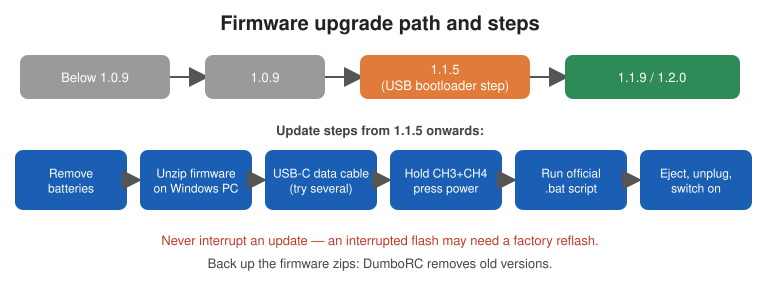

# DDF-350 Firmware and Modifications

## Official firmware updates

Firmware is on DumboRC's [firmware page](https://www.dumborc.com/?page_id=930) (Chinese). Current
versions: **1.2.0** (newest) and **1.1.9**; see the [version history](ddf-350.md#firmware-history-official).

### Upgrade path

| Your version | Steps |
|---|---|
| Below 1.0.9 | → 1.0.9 → 1.1.5 (USB bootloader update) → 1.1.9/1.2.0 |
| 1.0.9 – 1.1.4 | → 1.1.5 (USB bootloader update) → 1.1.9/1.2.0 |
| 1.1.5 or later | → 1.1.9/1.2.0 directly |

The 1.1.5 step has its own procedure — follow DumboRC's official video
([YouTube](https://www.youtube.com/watch?v=NK6ea4CEv3U), [Bilibili](https://www.bilibili.com/video/BV1uZ1VYrEJi)).

### Updating from 1.1.5 or later

1. **Remove the transmitter batteries.** It's powered by USB during the update.
2. Download and **unzip** the firmware on a Windows PC (7/8/10/11; XP also listed).
3. Connect a **USB-C data cable**. The transmitter is very fussy — if you get "USB device error" or no
   drive appears, try other cables until one works.
4. **Hold the CH3 and CH4 keys and press power.** The screen goes black and it chimes; release the keys.
   A USB drive appears on the PC.
5. Run the official **.bat** script from the firmware folder. Don't copy files by hand — Windows adds a
   "System Volume Information" folder that breaks the update.
6. When it finishes, **safely eject** the drive and unplug.
7. Switch on — the new firmware installs, then check the version.

**Never interrupt an update.** DumboRC warns an interrupted update means returning the transmitter to
the factory for reflashing with a programmer. **Back up** the firmware zips you use — DumboRC removes
old versions from its site.

After updating, check model settings and **recalibrate** (Transmitter settings → Calibration) if the
wheel or trigger centre looks off.

## Community firmware mod (ELynx ddf-350-modding)

An open-source patch for the official firmware by GitHub user ELynx. It's applied to an official
firmware file you download yourself; DumboRC doesn't support it.

| Mod version | For official firmware | Adds |
|---|---|---|
| **0.8.1** | 1.1.9 | **Lock CH1–CH4**: freezes steering, throttle, CH3 and CH4 at their last values (trims kept) while mixes still work — e.g. rev an engine-sound module while parked |
| **0.8.0** | 1.1.9 | **Cruise control override**: pulling the trigger past the cruise value adds throttle; releasing returns to cruise. Better English and German text (no scrolling). **4 × NiMH battery display** (4.0–5.6 V) and low-voltage alarm down to 4.1 V |

Battery display ranges in the mod: 4 × AA 4.0–6.0 V · 2S 6.0–8.4 V · 3S 9.0–12.6 V · 4 × NiMH 4.0–5.6 V.

### Installing the mod

1. Update to official **1.1.5** first if you're below it, then get the official **1.1.9** `DDF.bin`.
2. **Back up** the original 1.1.9 files.
3. Download **LunarIPS** and the latest `.ips` patch from the project's
   [releases](https://github.com/ELynx/ddf-350-modding/releases/latest).
4. Apply the patch to a **clean, unpatched** `DDF.bin` (not the boot files, not the zip). Patching an
   already patched file causes glitches.
5. Flash it using the official steps above.

Risks: no warranty, possible glitches; don't update the day before an event. To go back, flash the
clean official file.

## Hardware modifications and accessories

| Mod | Why | Notes |
|---|---|---|
| **2S Li-ion or LiPo pack** (JST plug) | Lighter than 4 × AA, longer runtime, steady voltage | Set battery type and low-voltage alarm by hand; charge it outside the radio — **not via USB-C** |
| **Screen protector** | The colour screen scratches | Cut-to-fit film or a model-specific protector |
| **Receiver upgrade** | Add gyro, telemetry, lights or 4WS channels | P10FG for crawlers; P6DCG for lights — see [Receivers](receivers.md) |
| **Light kit** (FZD, angel eyes, roof bar) | Scale lighting controlled from the radio | Plug into CH1–4 or a light receiver |
| **Engine-sound module** | Throttle-linked sound | Feed it from a program mix of throttle to a spare channel |
| **Simulator / head tracking** | Practice or FPV pan/tilt | PPM port in/out |
| **Trainer cable** | Teach a beginner | PPM port, trainer mode |
| **Wheel / grip grip-tape** | Better feel | Common cheap upgrade; no official parts listed |

## Sources

- DumboRC — [firmware page and changelog](https://www.dumborc.com/?page_id=930), [manual: firmware upgrade](https://www.dumborc.com/sms/) (Chinese, translated)
- DumboRC — [official 1.1.5 update video (YouTube)](https://www.youtube.com/watch?v=NK6ea4CEv3U), [Bilibili](https://www.bilibili.com/video/BV1uZ1VYrEJi)
- ELynx — [ddf-350-modding](https://github.com/ELynx/ddf-350-modding) (README, versions 0.8.0–0.8.1), [LunarIPS](https://fusoya.eludevisibility.org/lips)
- China-Gadgets — [DDF-350 review](https://www.china-gadgets.de/dumbo-rc-ddf-350/) (battery options, user comments about firmware downloads)
