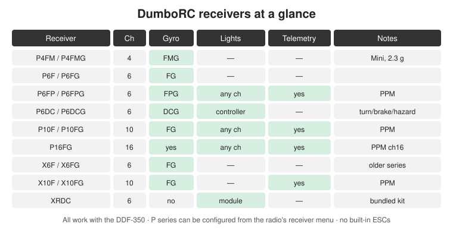
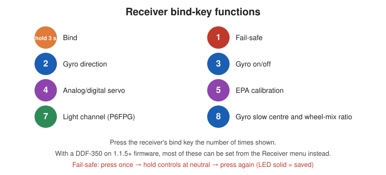

# Receivers Compatible with the DDF-350

DumboRC says the DDF-350 works with **all DumboRC receivers**. The radio is sold bundled with
different receivers depending on the seller (X10F, X10FG, P10F, P10FG, P4FM, P6DC, XRDC…), so check
which one you have.

## Naming

| Part of the name | Meaning |
|---|---|
| **G** at the end | Built-in **gyro** (steering stabilisation) |
| **DC** | **Light-controller** receiver (turn, brake, reverse, headlights, hazards) |
| **M** | **Mini** size |
| **P** prefix | Current series (P4/P6/P10/P16). Settable from the DDF-350's receiver menu |
| **X** prefix | Older series (X6F/X6FG, X10F/X10FG). Bind-key setup; **can't** be set from the receiver menu |
| **P6FP** | Newer 6-channel with PPM and telemetry |

## Comparison

From DumboRC's product pages and manuals.

| Receiver | Channels | Gyro | Lights | Voltage telemetry | Output | Size / weight | Voltage |
|---|---|---|---|---|---|---|---|
| **P4FM / P4FMG** | 4 | FMG only | — | — | PWM (ZH1.5 plugs) | 22 × 15 × 8.5 mm / 2.3 g | 4.8–10 V |
| **P6F / P6FG** | 6 | FG only | — | — | PWM | 35 × 20 × 13 mm / 6 g | 4.8–10 V |
| **P6FP / P6FPG** | 6 | FPG only | Any channel | ✅ (B+/B– lead) | PWM + PPM | 35 × 20 × 13 mm / 7 g | 4.8–10 V |
| **P6DC / P6DCG** | 6 | DCG only | ✅ Light controller | — | PWM + light outputs | 35 × 21 × 14 mm / 8 g | 4.8–10 V |
| **P10F / P10FG** | 10 | FG only | Any channel | ✅ (B+/B– lead) | PWM ×10 + PPM | 40 × 28 × 13.5 mm / 9.5 g | 4.8–10 V |
| **P16FG** | 16 | ✅ | Any channel; turn-signal port | ✅ | CH1–15 PWM + CH16 PPM (mode key) | — | — |
| **X6F / X6FG** | 6 | FG only | — | — | PWM | 35 × 20 × 13 mm | 3.3–10 V |
| **X10F / X10FG** | 10 | FG only | — | ✅ signal strength + battery | PWM + PPM | 40 × 28 × 14 mm / 12 g | 4.8–10 V |
| **XRDC** | 6 | No | ✅ Light module (bundled) | — | — | — | — |

Notes:
- All use Futaba-style servo plugs except the P4FM (ZH1.5).
- Range is 350 m for the P series; X6F/X6FG pages say "more than 400 m".
- No DumboRC receiver here has a built-in ESC.
- The P6F is described as an upgraded X6F.
- The DDF-350's **fast protocol** only drives CH1–4.

## Which to choose

| Use | Receiver |
|---|---|
| Crawler with 4WS, winch, lights, telemetry | **P10FG** (or X10FG) |
| Crawler with gyro, no extras | **P6FG** |
| Small or 1/24 crawler | **P4FMG** (2.3 g) |
| Scale truck with realistic lights | **P6DCG** (or P6DC + FZD light set) |
| 6-channel with battery telemetry | **P6FPG** |
| Boat or tank | P6F/P10F (no gyro needed); tank mix on the transmitter |
| Big builds with many functions | **P16FG** |

## Bind-key functions (P series and X6FG)

Most settings can be made from the DDF-350's menus, but the bind key on the receiver does the same
jobs — useful with older transmitters or X-series receivers.

| Presses of the bind key | Function |
|---|---|
| **Hold > 3 s** | Bind (LED flashes fast → solid when bound) |
| **1** | Fail-safe: LED flashes fast; hold the controls where you want them; press again → LED solid, saved |
| **2** | Gyro direction (phase) |
| **3** | Gyro on/off (orange LED = gyro on, green = off). Gyro gain 0 also turns it off |
| **4** | Digital/analog servo mode — **a mismatch makes the servo buzz, jitter and heat up** |
| **5** | EPA calibration |
| **7** (P6FPG) | Any-channel light setup |
| **8** | Gyro slow-centring and wheel-mix ratio (for transmitters without a screen) |

The P6F (no gyro) uses the same codes except the gyro and steering items.

## Light receivers and modules

### P6DC / P6DCG light controller

LED-key functions:

| Press | Function |
|---|---|
| 1 short | Throttle reverse setting |
| 2 short | Switch mode ↔ wheel mode |
| Long, 1 flash | Motion mode: CH1 drives turn signals; CH2 headlights, brake, reverse |
| Long, 2 flashes | Mix mode: lights work with transmitter mixes |
| Long, 3 flashes | Factory reset |

- **Switch mode (default):** CH1 turn signals, CH2 reverse + brake lights, CH3 double-flash, CH4
  headlights; wheel full right 4 times = hazards.
- **Wheel mode:** CH1 turn, CH2 reverse + brake; wheel full right ×2 = headlights, ×3 = double-flash,
  ×4 = hazards.
- Keep CH1 trim small (within the first indicator step) or the indicators may trigger. In mix mode
  leave CH1 and CH2 reverse switches at their left (normal) positions.

### Other light products

| Product | Details |
|---|---|
| **FZD light set** | 35 × 21 × 14 mm, 9.6 g; turn, headlights, brake, reverse, ambience, hazards; plugs into receiver CH1–4; works with pistol and stick radios; mix mode |
| **Angel/devil eyes** | Wire to a receiver (always on), a 3-channel light module, or YC/DC/FZD receivers for separate colours |
| **Roof light bar / chaser lights** | Photos only on DumboRC's site |
| **Any-channel lights** (P10F/G, P6FP/G, P16FG) | Assign any channel to switch LEDs |

## Sources

- DumboRC (Chinese, translated) — [P6F/P6FG](https://www.dumborc.com/?p=427), [P6DC/P6DCG](https://www.dumborc.com/?p=708), [P4FM/P4FMG](https://www.dumborc.com/?p=820), [P10F/P10FG](https://www.dumborc.com/?p=775), [P6FP/P6FPG](https://www.dumborc.com/?p=1072), [P6FG manual](https://www.dumborc.com/sms/docs/%E6%8E%A5%E6%94%B6%E6%9C%BA/P6FG%E6%8E%A5%E6%94%B6%E6%9C%BA), [P10FG manual](https://www.dumborc.com/sms/docs/%E6%8E%A5%E6%94%B6%E6%9C%BA/P10FG%E6%8E%A5%E6%94%B6%E6%9C%BA/), [P4FMG manual](https://www.dumborc.com/sms/docs/%E6%8E%A5%E6%94%B6%E6%9C%BA/P4FMG%E6%8E%A5%E6%94%B6%E6%9C%BA/), [P6FPG manual](https://www.dumborc.com/sms/docs/%E6%8E%A5%E6%94%B6%E6%9C%BA/P6FPG%E6%8E%A5%E6%94%B6%E6%9C%BA/), [P6DCG manual](https://www.dumborc.com/sms/docs/%E6%8E%A5%E6%94%B6%E6%9C%BA/P6DCG%E6%8E%A5%E6%94%B6%E6%9C%BA/), [P16FG manual](https://www.dumborc.com/sms/docs/%E6%8E%A5%E6%94%B6%E6%9C%BA/P16FG%E6%8E%A5%E6%94%B6%E6%9C%BA/), [FZD light set](https://www.dumborc.com/?p=716), [angel eyes](https://www.dumborc.com/?p=721), [roof lights](https://www.dumborc.com/?p=830)
- DumboRC (English) — [X6F](https://www.dumborc.com/en/2019/07/15/x6f-receiver/), [X6FG](https://www.dumborc.com/en/2019/07/13/x6fg-receiver-with-gyro-inside/)
- DumboRC — [DDF-350 manual: features (X10F/X10FG specs)](https://www.dumborc.com/sms/docs/%E9%81%A5%E6%8E%A7%E5%99%A8/DDF350/%E9%81%A5%E6%8E%A7%E5%99%A8%E7%AE%80%E4%BB%8B/%E5%8A%9F%E8%83%BD%E7%89%B9%E7%82%B9/)
- HobbyKing — [DDF-350 with XRDC receiver and light module](https://hobbyking.com/dumborc-ddf-350-2-4ghz-10ch-steer-wheel-transmitter-w-lcd-screen-xrdc-6ch-receiver-w-light-module.html?stock_id=5)
- Helidirect — [P6F receiver](https://www.helidirect.com/products/dumborc-p6f-6-channels-2-4ghz-rc-receiver)
- manuals.plus — [X6F/X6FG manual](https://manuals.plus/asin/B0DHKP7D83), [P10FG](https://manuals.plus/asin/B0CR6F9PKB) (reference)
