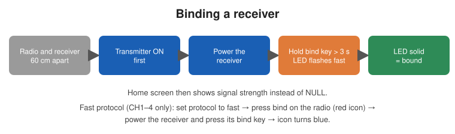
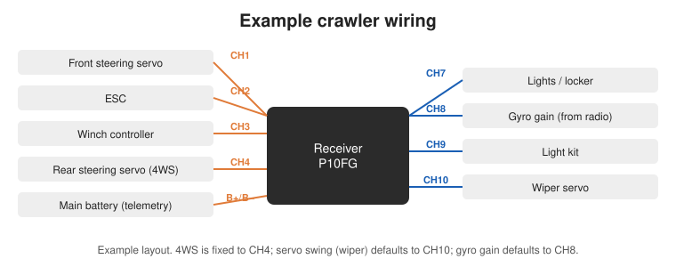
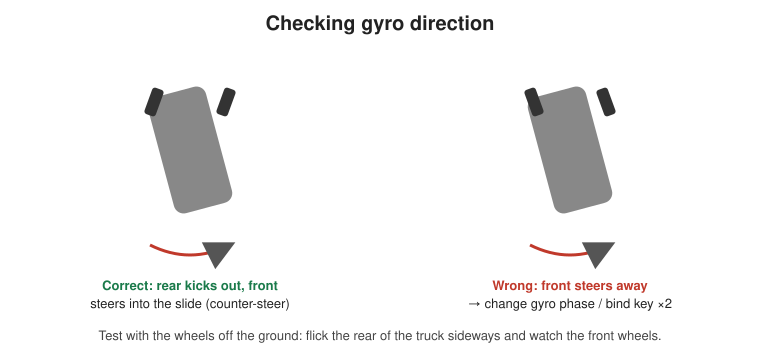

# DDF-350 Setup Guide

Step-by-step setup for a crawler or scale truck, from first power-on to gyro, 4WS, winch and lights.
Menu names are the English UI; see [DDF-350](ddf-350.md) for the full menu reference.

## Contents

1. [Power and first start](#1-power-and-first-start)
2. [Update the firmware](#2-update-the-firmware)
3. [Create a model](#3-create-a-model)
4. [Bind a receiver](#4-bind-a-receiver)
5. [Wire the receiver](#5-wire-the-receiver)
6. [Directions, travel and trims](#6-directions-travel-and-trims)
7. [Fail-safe](#7-fail-safe)
8. [Gyro](#gyro)
9. [Crawler functions](#9-crawler-functions)
10. [Lights](#10-lights)
11. [Recipes](#11-recipes)

---

## 1. Power and first start

- **Batteries:** 4 × AA, or a **2S–3S Li-ion/LiPo pack** with a JST plug in the battery bay.
  Set **Power → battery type** to match and set the **low-voltage alarm by hand** — it doesn't change
  automatically with battery type. Typical alarm points: 4.4 V for 4 × AA, 7.0 V for 2S, 10.5 V for 3S.
- **Don't charge through USB-C.** It's for firmware, data and temporary power only.
- **Switch on:** hold HOME about 1.5 s.
- **Order:** trigger and trims centred → transmitter on → check throttle and battery → **then** the
  receiver/vehicle. Switch off in the opposite order (vehicle first).
- **Language:** from the power-key system menu (default English).

## 2. Update the firmware

Many features (4WS, dual rate, transmitter-side gyro and fail-safe) need **1.1.5 or later**. Check the
version in the system menu and update first — see [Firmware and Modifications](firmware-and-mods.md).

## 3. Create a model

**Transmitter settings → Model:** pick a free slot (10 total), rename it (e.g. "TRX4 Bronco"). Copy an
existing model to start from its settings. **Reset** wipes the slot permanently.

## 4. Bind a receiver

**Standard protocol (all receivers, 10 channels):**
1. Transmitter and receiver about **60 cm apart**.
2. Switch the **transmitter on first**, then power the receiver.
3. Hold the receiver's **bind key for more than 3 seconds** — its LED flashes fast.
4. When the LED goes **solid**, it's bound. The home screen shows signal strength instead of **NULL**.

**Fast protocol (CH1–4 only, lower latency):**
1. **Receiver settings → Receiver → protocol: fast**.
2. Press **bind** on the transmitter (icon turns red).
3. Power the receiver and press its bind key — the icon turns **blue** when bound.
4. CH5–CH10 won't respond in fast mode.

## 5. Wire the receiver

| Receiver channel | Typical crawler use |
|---|---|
| CH1 | Steering servo (front) |
| CH2 | ESC throttle |
| CH3 | Two-speed / dig servo, or winch (winch mix) |
| CH4 | **Rear steering servo (4WS mix is fixed to CH4)** |
| CH5, CH6 | Knob functions: cruise speed, light dimmer, extra servo |
| CH7 | 3-position switch: lights or locker |
| CH8 | Gyro gain (default) |
| CH9 | Lights / accessories |
| CH10 | Wiper (servo swing default) |
| B+/B– (P10F/G, P6FP/G) | Battery-voltage telemetry lead to the main battery |

The ESC's BEC usually powers the receiver. **Servo mode:** set analog/digital to match the servo
(**Receiver settings** or bind key ×4) — the wrong mode makes servos buzz and heat up.

## 6. Directions, travel and trims

1. **Basic settings → Servo view** — move each control and watch the bars.
2. **Channel reverse** any channel that moves the wrong way (steering left must turn the wheels left).
3. **Sub-trim** to centre the steering servo with the wheels straight (keep the trim switch at 0).
4. **Channel travel (EPA):** turn steering to full lock each way and reduce travel until the servo
   stops just before the steering stops (no buzzing). Throttle: leave 100 % unless the ESC manual says
   otherwise; then **calibrate the ESC** to the radio.
5. **Dual rate** on a switch if you want a reduced-steering mode for trail driving.
6. **Curves:** soften the throttle curve near neutral for fine crawl control; leave steering linear or
   add a little expo-like softening around centre.

## 7. Fail-safe

Set it so the truck **stops** if the signal is lost.

- **From the transmitter (1.1.5+, P series):** Receiver settings → Receiver/Gyro → **Set fail-safe**:
  hold throttle at **neutral** (steering centre), press set — the receiver LED flashes once.
- **From the receiver:** press the bind key **once** (LED flashes fast), hold the controls at the
  fail-safe positions, press again (LED solid) to save.
- **Test:** wheels off the ground, apply a little throttle, switch the transmitter off — the motor must
  stop.

## Gyro

The gyro (G receivers) corrects steering to keep the truck straight — helpful for fast trail and
drifting, less so for slow technical crawling.

1. Mount the receiver **flat and firm**, aligned with the chassis.
2. **Gyro on:** Receiver settings → Gyro → enable (or bind key ×3: orange LED = on).
3. **Gain control:** Advanced settings → Gyro mix → gain channel **CH8** (default), VR-5 or VR-6.
4. **Direction check:** wheels off the ground, flick the rear of the truck to the left — the front
   wheels must steer **right** (counter-steer). If they steer the wrong way, change **gyro phase**
   (or bind key ×2).
5. **Gain:** start around 30–50 %, increase until the steering wobbles, then back off.
6. **Slow centring and wheel-mix ratio** (Receiver settings → Gyro): more wheel-mix gives you more
   authority over the gyro; slow centring smooths the return.
7. **Gain 0 disables** the gyro — handy on a knob for crawling.

## 9. Crawler functions

| Function | Menu | Setup |
|---|---|---|
| **4WS** | Advanced → 4WS mix | Rear servo on **CH4**. Assign switch positions for same-phase (crab) and opposite-phase (tight turn); set left/right ratios; reverse CH4 if the rear steers the wrong way; set CH4 travel and sub-trim |
| **Winch** | Advanced → Winch mix | Winch controller on CH3; choose up/down keys (K-3/K-4 or K-8/K-9/K-10) and speeds |
| **Cruise** | Advanced → Cruise control | Mode 2 with VR-5/VR-6 sets a crawl speed you can hold hands-free; cancel with reverse or the key |
| **Two-speed / lockers** | Key type (latching) or SW-7 | Set travel so servos don't strain at the ends |
| **Wiper** | Advanced → Servo swing | Servo on **CH10**; Mode 1 speeds on a key, or Mode 2 speed on a knob; set A/B angles |
| **Program mix** | Advanced → Program mix | E.g. throttle → CH5 for an engine-sound module; brake lights from CH2 |
| **Tank** | Advanced → Tank mix | Left/right tracks on CH1/CH2 outputs; set ratios |

## 10. Lights

- **P6DC/P6DCG:** connect LEDs to the receiver's light outputs; choose switch mode (CH3 hazards, CH4
  headlights) or wheel mode (turn the wheel fully right 2/3/4 times). See [Receivers](receivers.md#p6dc--p6dcg-light-controller).
- **P10F/G, P6FP/G, P16FG:** any channel can switch LEDs; assign with the LED/mode key.
- **FZD light set** on any receiver: plug into CH1–4.

## 11. Recipes

### Technical rock crawler (4WS, winch)

- Receiver: P10FG with **gyro off** (or gain on a knob at 0).
- Throttle curve softened near neutral; dual rate off.
- 4WS on SW-7 (crab / normal / counter); winch on K-3/K-4.
- Cruise mode 2 on VR-5 for slow, steady climbs.
- Fail-safe: throttle neutral.

### Trail / scale truck with lights

- Receiver: P6DCG or P10FG + FZD lights; gyro gain ~30 % on CH8.
- Dual rate on a key for a gentler road mode.
- Headlights on K-8, hazards on K-9; wiper on CH10.
- Telemetry lead on the main battery and a voltage alarm.

### Drift / fast trail

- Receiver: P10FG or P6FG with gyro; fast protocol if you only need CH1–4.
- Gyro gain 50–80 %; steering curve softened around centre.

## Sources

- DumboRC DDF-350 manual (Chinese, translated) — [index](https://www.dumborc.com/sms/), [power-on](https://www.dumborc.com/sms/docs/%E9%81%A5%E6%8E%A7%E5%99%A8/DDF350/%E9%81%A5%E6%8E%A7%E5%99%A8%E7%AE%80%E4%BB%8B/%E5%BC%80%E6%9C%BA%E6%93%8D%E4%BD%9C/), [precautions](https://www.dumborc.com/sms/docs/%E9%81%A5%E6%8E%A7%E5%99%A8/DDF350/%E9%81%A5%E6%8E%A7%E5%99%A8%E7%AE%80%E4%BB%8B/%E6%B3%A8%E6%84%8F%E4%BA%8B%E9%A1%B9/)
- DumboRC receiver manuals — see [Receivers](receivers.md#sources)
- Arrma Forum — [DumboRC gyro discussion](https://arrmaforum.com/threads/dumbo-rc.22849/), [gyro mounting orientation](https://www.arrmaforum.com/threads/dumborc-gyro-mounting-orientation.27008/latest)
- Gyro gain, direction check and alarm voltages are general RC practice, not DumboRC figures.
