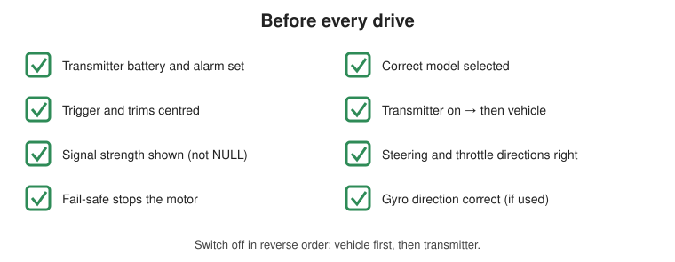

# DDF-350 Tips and Troubleshooting

## Tips

- **Update to 1.1.5 or later first.** Many features in reviews and videos (4WS, dual rate,
  transmitter-side gyro and fail-safe) don't exist on older firmware.
- **Back up firmware files** — DumboRC removes old versions.
- **Name every model** and copy a working model as the starting point for the next truck.
- **Use Servo view** after every change to check reverses and mixes before driving.
- **Set the low-voltage alarm yourself** after changing battery type; it isn't automatic.
- **Use a 2S Li-ion/LiPo pack** for lighter weight and longer runtime (charge it outside the radio).
- **Match servo mode** (analog/digital) to the servo — a mismatch makes servos buzz and overheat.
- **Keep CH1 trim small** with P6DC(G) light receivers, or indicators can come on by themselves.
- **4WS rear servo must be on CH4**; plan your wiring around that.
- **Fast protocol** only gives CH1–4 — use standard if you need winch, lights or gyro gain channels.
- **Gyro on a knob** (gain 0 = off) lets you switch between crawling (off) and trail (on).
- **Set fail-safe to throttle neutral** and test it with the wheels off the ground.
- **Telemetry:** connect the B+/B– lead (P10F/G, P6FP/G) to the main battery to see its voltage on the
  home screen.

## Troubleshooting

| Problem | Likely cause | Fix |
|---|---|---|
| Home screen shows **NULL** | Not bound, receiver off, or wrong protocol | Rebind; check standard/fast protocol matches |
| CH5–CH10 do nothing | **Fast protocol** selected | Switch to standard and rebind |
| Servo buzzes, jitters, gets hot | Analog/digital mode wrong, or travel past the mechanical stop | Fix servo mode; reduce EPA |
| Steering drifts with gyro on | Gyro direction reversed or receiver not flat | Change gyro phase; remount receiver flat and firm |
| Steering wobbles | Gyro gain too high | Reduce gain |
| Rear wheels steer the wrong way (4WS) | CH4 reversed | Reverse CH4 or swap same/opposite phase |
| Indicators flash by themselves (P6DC) | CH1 trim too far off centre | Reduce trim; use sub-trim/servo arm instead |
| Neutral creep | ESC not calibrated to the radio | Calibrate the ESC; check throttle trim is 0 |
| Wheel/trigger centre wrong after update | Calibration lost | Transmitter settings → Calibration |
| PC doesn't see the transmitter | Charge-only or incompatible USB cable | Try other data cables; hold CH3+CH4 while powering on |
| Update interrupted | — | Don't retry blindly; contact DumboRC (may need factory reflash) |
| Low-voltage alarm at wrong time | Alarm not set for the battery type | Power → set the alarm voltage by hand |

## Sources

Compiled from the DumboRC DDF-350 and receiver manuals, the DumboRC firmware page, the ELynx modding
project and reviews — see [DDF-350](ddf-350.md#sources), [Receivers](receivers.md#sources) and
[Firmware and Modifications](firmware-and-mods.md#sources).
